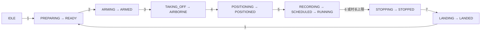

# PX4_sim 使用手册：三车六机 NE / TVFT 闭环仿真

适用分支：`PX4_sim`。本文按该分支的 launch、YAML 和 Python 实现整理，更新于 2026-11-03。已有运行结果单独保存在 [PX4_SIM_RESULTS.md](PX4_SIM_RESULTS.md)，本文说明如何启动、操作、改参数和检查数据。

## 目录

1. [系统组成与目录](#1-系统组成与目录)
2. [安装、编译与首次启动](#2-安装编译与首次启动)
3. [launch 入口与参数](#3-launch-入口与参数)
4. [指令与状态机](#4-指令与状态机)
5. [ROS 话题、服务与坐标系](#5-ros-话题服务与坐标系)
6. [分组、初始位置与通信拓扑](#6-分组初始位置与通信拓扑)
7. [圆周编队参数](#7-圆周编队参数)
8. [环境监测代价函数与 NE](#8-环境监测代价函数与-ne)
9. [在线控制律与增益](#9-在线控制律与增益)
10. [限幅、时序与健康检查](#10-限幅时序与健康检查)
11. [通信时延工况](#11-通信时延工况)
12. [记录、文件命名与分析](#12-记录文件命名与分析)
13. [常用操作与排查](#13-常用操作与排查)
14. [源码索引与验证范围](#14-源码索引与验证范围)

## 1. 系统组成与目录

三个 UGV 是一阶领导者，通过分布式位置博弈寻找工作位置；每辆车带两架二阶 UAV，执行相对该车的时变圆周编队。监督器负责阶段协调，九个 agent 各自计算控制量，记录器异步保存数据。监督器不集中计算九台机器人的控制输入。

使用的可视化和动力学平台为 [swarm_sync_sim](https://github.com/shupx/swarm_sync_sim)，固定版本 `4837b511c3d2bcaa36448e5e5af51335004bafd8`。平台采用改写自 PX4 v1.13.3 的控制模块、真值反馈和四旋翼动力学，并提供模拟 MAVROS 接口；它不等同于运行完整 PX4-Autopilot 固件的 SITL。

宿主机 `/home/bjl/xgc_ws` 映射到 `xgc` 容器内 `/home/xgc_ws`。下表路径均为容器内路径：

| 路径 | 用途 |
|---|---|
| `/home/xgc_ws/src/hete_TVFT_NE` | 本实验源码；当前应检出 `PX4_sim` |
| `/home/xgc_ws/swarm_sync_sim` | 独立的上游平台 catkin 工作空间 |
| `/home/xgc_ws/sss_experiment_ws` | 本分支实验 overlay，`src/ne_tvft_experiment` 链接到本实验 |
| 本仓库 `config/sss_experiment.yaml` | 编队、博弈、控制增益、时序、仿真参数 |
| 本仓库 `config/topics.yaml` | 九台机器人的话题、服务和坐标变换 |
| 本仓库 `integration/swarm_sync_sim.patch` | 为模拟 MAVROS 补充真实落地状态消息 |
| 本仓库 `output/`、`picture/` | 原始数据与分析结果，详见第 12 节 |

不需要依赖 `/tmp` 中的源码副本。不要用整个 `/home/xgc_ws/src` 的全量编译代替上述独立工作空间：旧参考目录 `group_matlab2ROS` 内存在同名仿真包。

`experiment/communication-delay` 是另一条实验分支。该分支去除 300 ms 邻居保护后的测试、结果目录及其 overlay 不属于本文的 `PX4_sim` 配置。当前 `PX4_sim` 仍使用 `runtime.signal_timeout: 0.3`。

## 2. 安装、编译与首次启动

先在宿主机确认分支和工作区：

```bash
cd /home/bjl/xgc_ws/src/hete_TVFT_NE
git status --short
git switch PX4_sim
docker exec -it xgc bash
```

以下命令在容器中执行：

```bash
cd /home/xgc_ws/src/hete_TVFT_NE
bash scripts/setup_sss_workspace.sh /home/xgc_ws
source /home/xgc_ws/sss_experiment_ws/devel/setup.bash
rospack find ne_tvft_experiment
roslaunch ne_tvft_experiment sss.launch
```

安装脚本完成：获取或核对上游固定版本，幂等应用落地状态补丁，编译 `sss_sim_env`、`px4_rotor_sim`、`ugv_sim`，创建实验 overlay 并编译。脚本不写 `.bashrc`，不修改原参考包。若平台位于其他版本且已有本地修改，脚本会停止，需先检查平台工作区。

每个新容器终端均需 source 同一个 overlay。启动前后不要切换本仓库分支；overlay 链接的是当前源码，并不保存一份独立的 `PX4_sim` 副本。

在第二个容器终端检查接口：

```bash
source /home/xgc_ws/sss_experiment_ws/devel/setup.bash
cd /home/xgc_ws/src/hete_TVFT_NE
python3 scripts/preflight.py --config config/sss_experiment.yaml --backend sss --ros
rostopic echo /ne_tvft/session
```

`preflight` 检查配置、拓扑、博弈证书、仿真时钟、反馈话题类型以及执行话题是否存在多个发布者。检查通过后按第 4 节依次操作。

## 3. launch 入口与参数

### 3.1 `sss.launch`：完整平台实验

入口为 [launch/sss.launch](launch/sss.launch)。它启动一个共享仿真时钟、三辆麦轮车、六架四旋翼、九个 agent、监督器、记录器，以及可选的统一 RViz。UGV 使用 `ugv_type=0`；UAV 使用 `local_pos_source=0`，共享世界坐标原点。

| 参数 | 默认值 | 含义 |
|---|---|---|
| `open_rviz` | `true` | 显示九台机器人及轨迹 |
| `open_clock_ui` | `false` | 显示平台时钟面板 |
| `max_speed_ratio` | `1` | 平台仿真速度倍率上限 |
| `config` | 包内 `config/sss_experiment.yaml` | 实验参数文件 |
| `communication` | 包内 `config/communication_none.yaml` | 通信时延配置覆盖文件 |
| `output_root` | 包内 `output` | 原始记录根目录 |
| `picture_root` | 包内 `picture` | 分析结果根目录 |

```bash
# 无图形界面
roslaunch ne_tvft_experiment sss.launch open_rviz:=false

# 显示时钟面板
roslaunch ne_tvft_experiment sss.launch open_clock_ui:=true

# 正态随机时延
roslaunch ne_tvft_experiment sss.launch \
  communication:=/home/xgc_ws/src/hete_TVFT_NE/config/communication_normal.yaml

# 自定义配置和记录路径
roslaunch ne_tvft_experiment sss.launch \
  config:=/home/xgc_ws/src/hete_TVFT_NE/config/my_sss.yaml \
  output_root:=/home/xgc_ws/my_sss_results/output \
  picture_root:=/home/xgc_ws/my_sss_results/picture
```

`my_sss.yaml` 是用户自行从默认 YAML 复制的示例文件名，仓库不预置该文件。配置在启动时加载，运行中修改磁盘 YAML 或直接 `rosparam set` 不会完整更新所有节点；参数实验应结束当前运行后重新 launch。

### 3.2 `experiment.launch`：只启动实验层

[launch/experiment.launch](launch/experiment.launch) 的默认值为 `mock=true`、`backend=auto`、`allow_hardware=false`、`config=experiment.yaml`。它默认走 mock，不会单独启动 SSS 车辆和时钟。另有 `topics` 参数，默认 `config/topics.yaml`；通信、记录路径参数与上表同名。

`sss.launch` 内部明确指定 `mock=false`、`backend=sss`、`allow_hardware=false`。SSS 后端要求 `/use_sim_time` 和 `/use_sss_sim_time` 都为 true。当前 `sss.launch` 不向外暴露 `topics` 参数；若需更换接口文件，需要调整其 include 或自行组合实验层和平台层。

配置按“实验 YAML → topics YAML → communication YAML → launch 中记录路径”顺序加载到 `/ne_tvft/config`。最后一项路径覆盖 YAML 的 logging 根目录。

### 3.3 一键隔离闭环测试

```bash
cd /home/xgc_ws/src/hete_TVFT_NE
bash scripts/run_sss_test.sh 80
bash scripts/run_sss_test.sh 80 communication_50ms.yaml
bash scripts/run_sss_test.sh 80 communication_normal.yaml

# 自动测试时同时显示 RViz
NE_TVFT_OPEN_RVIZ=true bash scripts/run_sss_test.sh 80
```

第一个参数是正式控制时长，单位秒，不包含准备、起飞和降落时间；第二个参数是 `config/` 下的通信配置文件名。脚本启动独立的回环地址 ROS master，自动执行指令 1–7，检查阶段、正式段数据、起始偏差、记录与降落反馈，再运行分析程序。失败返回非零并保留日志；脚本会尝试停止、降落及清理其启动的进程。

测试持续时间应小于默认 `max_run_seconds=120`，或先为更长实验同步修改该参数。一键脚本会自行 source `sss_experiment_ws`，但仍应在检出 `PX4_sim` 后执行。

## 4. 指令与状态机

操作入口为 `/command`，类型 `std_msgs/Int32`。在另一个已 source 的终端逐条发送，每次等待目标阶段再继续，不要一次连续发送 1–7：

```bash
rostopic pub -1 /command std_msgs/Int32 'data: 1'
# 另开终端持续查看状态
rostopic echo /ne_tvft/session
```

| 指令 | 允许的起始阶段 | 阶段变化 | 实际动作与完成条件 |
|---|---|---|---|
| `1` | `IDLE / STOPPED / LANDED` | `PREPARING → READY` | 重置会话，准备控制器，检查九台实体的反馈与就绪状态 |
| `2` | `READY` | `ARMING → ARMED` | 连续发送 setpoint 预热，切 OFFBOARD，再解锁；以 FCU 实际 mode/armed 反馈确认 |
| `3` | `ARMED` | `TAKING_OFF → AIRBORNE` | UAV 保持起飞时 XY，爬升至各组 altitude；高度误差、速度满足容差并持续就绪时间 |
| `4` | `AIRBORNE / STOPPED` | `POSITIONING → POSITIONED` | UGV 到组初始点，UAV 到对应圆周初始点和高度；位置、速度和驻留时间均满足要求 |
| `5` | `POSITIONED` | `RECORDING → SCHEDULED → RUNNING` | 创建记录会话，确认记录器和 rosbag 就绪，协调未来统一 `t0`，到时开始 NE / TVFT 控制 |
| `6` | 任意阶段 | `STOPPING → STOPPED` | UGV 零速度；UAV 先零速度制动，稳定后锁定当时位置悬停 |
| `7` | `AIRBORNE / POSITIONED / STOPPED / FAULT` | `LANDING → LANDED` | SSS 下 OFFBOARD 下降，确认接地、低速、地面高度及健康反馈，再解除解锁并确认实际反馈 |

同一指令在其已请求或已完成阶段重复发送是幂等操作，不重新开日志或重置控制器；其他非法跳转会被拒绝。`RUNNING` 中不能直接通过指令 7 降落，应先 `6`，等 `STOPPED` 后再 `7`。



上图表示正常操作主路径；所有阶段还可能因异常进入 `FAULT`。完整允许关系以上表及 [protocol.py](src/ne_tvft/protocol.py) 为准。

**统一启动时间。** 指令 5 后，记录器先创建文件并确认 bag 已打开；监督器设置 `t0 = 当前 ROS 时间 + 2 s`。各 agent 确认 session、`t0`、邻居信号及准备状态后，监督器提交 `RUNNING`。`RUNNING` 状态可能早于 `t0` 出现，实际控制仅在到达 `t0` 后开启；提交确认需在 `t0 - 0.2 s` 前完成。遥测的 `start_offset` 记录首次正式控制相对 `t0` 的偏差。

**停止与故障。** 达到 `max_run_seconds=120` 自动进入 `STOPPING`，不会自动降落。`FAULT` 时控制器停止正式迭代，执行制动/保持策略；应查看 `reason`、agent 的 `fault_reason` 和传感器反馈，排除故障后完成降落。UAV 的故障锁存只在重新准备且已落地、未解锁等条件下清除，不能把空中发送指令 1 当作通用故障复位。

**SSS 降落适配。** 上游没有完整 Navigator 的 AUTO.LAND 任务，SSS 后端以 `simulation.landing_speed=0.2 m/s` 下降位置参考。解除解锁需要新鲜的 `landed_state=1`、高度不超过 `ground_z + 0.05 m`、低速及健康反馈；服务返回成功本身不代表阶段完成。硬件后端的 AUTO.LAND 路径与此不同。

## 5. ROS 话题、服务与坐标系

以下是 `sss.launch` 的实际名称，无 `/mock` 前缀。`N` 表示对应实体编号；话题方向以实验节点为参照。反馈坐标使用世界系 `map`，数值为 ROS ENU：x 东、y 北、z 上。

### 5.1 UGV：`N=1,2,3`

| 话题 | 类型 | 方向与含义 |
|---|---|---|
| `/ugvN/pose` | `geometry_msgs/PoseStamped` | 输入：世界位置与姿态 |
| `/ugvN/twist` | `geometry_msgs/TwistStamped` | 输入：世界系速度 |
| `/ugvN/imu` | `sensor_msgs/Imu` | 输入：原始 IMU，用于记录诊断 |
| `/ugvN/cmd_vel` | `geometry_msgs/Twist` | 输出：车体系平面速度，x 向前、y 向左；当前不主动控制车体转向 |

UGV 平面控制先在世界系计算，再按当前 yaw 转到车体系；因此不能把世界系 `u_x/u_y` 直接视为 cmd_vel 的原始字段。

### 5.2 UAV：`N=1,…,6`

| 话题 | 类型 | 方向与含义 |
|---|---|---|
| `/uavN/mavros/local_position/pose` | `geometry_msgs/PoseStamped` | 输入：位置、姿态 |
| `/uavN/mavros/local_position/velocity_local` | `geometry_msgs/TwistStamped` | 输入：世界 ENU 速度数值 |
| `/uavN/mavros/imu/data` | `sensor_msgs/Imu` | 输入：原始 IMU，不等同于世界系运动加速度 |
| `/uavN/mavros/state` | `mavros_msgs/State` | 输入：connected、armed、mode |
| `/uavN/mavros/extended_state` | `mavros_msgs/ExtendedState` | 输入：模拟器自身落地检测，`1` 接地、`2` 在空 |
| `/uavN/mavros/setpoint_raw/local` | `mavros_msgs/PositionTarget` | 输出：位置、速度或加速度参考，按阶段切换 |

| 服务 | 类型 | 用途 |
|---|---|---|
| `/uavN/mavros/cmd/arming` | `mavros_msgs/CommandBool` | 请求解锁/解除解锁 |
| `/uavN/mavros/set_mode` | `mavros_msgs/SetMode` | 请求 OFFBOARD 等模式 |

UAV 的 PositionTarget 使用 `coordinate_frame=1`（`FRAME_LOCAL_NED` 枚举），但 ROS 消息的输入数值按 MAVROS 接口约定为 ENU，由 MAVROS/模拟适配转换；本实验不额外做一次 ENU/NED 交换。掩码如下，均保留 yaw、忽略 yaw_rate，默认 yaw=0：

| 控制阶段/用途 | `type_mask` | 有效参考 |
|---|---:|---|
| 位置保持、起飞、初始点、SSS 降落 | `2552` | position + yaw |
| 制动 | `2503` | velocity + yaw |
| 正式 NE / TVFT 跟随 | `2111` | acceleration_or_force + yaw，以加速度方式使用 |

正式段水平加速度来自 TVFT，竖直加速度来自高度 PD，不额外添加重力。上游 `velocity_local.header.frame_id` 标为 `base_link`，但源码发布的是转换后的 ENU 数值；当前 `velocity_frame: world` 按此数值语义使用，没有再次旋转成世界系。

### 5.3 实验协议与时钟

| 话题 | 类型 | 发布/使用者与内容 |
|---|---|---|
| `/command` | `std_msgs/Int32` | 操作者或测试脚本 → 监督器，指令 1–7 |
| `/ne_tvft/session` | `std_msgs/String` | 监督器广播 JSON：phase、session_id、t0、stamp、reason；锁存发布 |
| `/ne_tvft/events` | `std_msgs/String` | 监督器阶段事件 JSON，记录器订阅 |
| `/ne_tvft/telemetry` | `std_msgs/String` | 九个 agent 的遥测 JSON，监督器/记录器订阅 |
| `/ne_tvft/recorder_status` | `std_msgs/String` | 记录器 JSON：会话、ready、healthy、closed、丢弃/错误诊断 |
| `/ne_tvft/signal/ugv1` 至 `/ne_tvft/signal/ugv3` | `std_msgs/String` | 对应 leader 发布 y、z、w 及会话/时间戳 |
| `/ne_tvft/signal/uav1` 至 `/ne_tvft/signal/uav6` | `std_msgs/String` | 对应 follower 发布 w 及会话/时间戳 |
| `/clock` | `rosgraph_msgs/Clock` | 平台统一 ROS 仿真时间 |
| `/sss_time_client/update_clock_request` | `sss_sim_env/TimeRequest` | 注册的时间客户端请求推进至下一回调时刻 |

JSON 协议版本为 `version: 1`。agent 遥测包含 `id/group/role/phase/healthy/ready`、位置速度、控制器内部量、原始/实际输入、限幅标志、setpoint、`start_offset`、backend 和通信诊断等。控制器只消费拓扑允许的 `/ne_tvft/signal/*`，不从全局遥测获取其他非邻居的真实状态。

平台还提供 `/sss_timeclient_register`（`sss_sim_env/ClientRegister`）、`/sss_timeclient_unregister`（`sss_sim_env/ClientUnregister`）、`/sss_clock_control`（`sss_sim_env/SimClockControl`）。这些是平台时钟接口，正常运行由程序管理。

RViz 使用 `/tf`、`/tf_static` 和各机器人命名空间中的 `joint_states`、`history_path`、`marker_name` 等可视化数据。`/<机器人>/robot_description` 是参数，不是话题；这部分不参与 NE / TVFT 控制。

## 6. 分组、初始位置与通信拓扑

| 组 | UGV / 初始 XY，m | 第一架 UAV / 初始 XY，m | 第二架 UAV / 初始 XY，m | UAV 高度，m |
|---|---|---|---|---:|
| 1 | ugv1 / `(-1.6, -1.4)` | uav1 / `(-1.25, -1.4)` | uav2 / `(-1.95, -1.4)` | 1.2 |
| 2 | ugv2 / `(1.6, -1.4)` | uav3 / `(1.95, -1.4)` | uav4 / `(1.25, -1.4)` | 1.2 |
| 3 | ugv3 / `(0, 1.6)` | uav5 / `(0.35, 1.6)` | uav6 / `(-0.35, 1.6)` | 1.2 |

表中 UAV 初始点是指令 4 的目标，即 `groups[i].initial_xy + h_ij(0)`，Z 为该组 `altitude`。默认 launch 的出生 XY 恰好与这些值一致，但所有实体出生 Z 为 0。

**出生点与正式初始点是两套设置。** `groups.initial_xy`、formation 和 altitude 决定控制器的初始目标；`sss.launch` 的 `init_*` 参数决定模型出生位置，当前为显式常量。修改半径、相位或初始点后，指令 4 会移动到新目标，模型不会自动在新点出生；若也希望改变出生位置，要同步修改 launch。

领导者邻接矩阵、每组跟随者邻接矩阵和 pinning：

```text
leaders A = [[0, 1, 0],       followers B = [[0, 1],
             [1, 0, 1],                      [1, 0]]
             [0, 1, 0]]      每组 pinning = [1, 0]
```

矩阵元素 `A[i,k] > 0` 表示 i 接收 k。实际控制信号订阅关系：

| agent | 接收的邻居信号 |
|---|---|
| ugv1 | ugv2 |
| ugv2 | ugv1、ugv3 |
| ugv3 | ugv2 |
| uav1 / uav2 | uav1 接收 ugv1、uav2；uav2 接收 uav1 |
| uav3 / uav4 | uav3 接收 ugv2、uav4；uav4 接收 uav3 |
| uav5 / uav6 | uav5 接收 ugv3、uav6；uav6 接收 uav5 |

当前实现校验领导者图为连通、无自环的非负无向图；各组跟随者图加 pinning 后须扎根于本组 leader。核心支持每组恰好两个 follower；launch 固定三组九台实体，仅修改 YAML 的实体数量不能自动扩展仿真场景。

## 7. 圆周编队参数

以组索引 i、组内 follower 索引 j=0,1、正式控制时间 `τ = ROS_time - t0` 表示：

$$
\theta_{ij}(\tau)=\omega_i\tau+\phi_i+j\pi,\qquad
h_{ij}(\tau)=r_i[\cos\theta_{ij},\ \sin\theta_{ij}]^T,
$$

$$
\dot h_{ij}=\omega_i[-h_{ij,y},\ h_{ij,x}]^T,\qquad
\ddot h_{ij}=-\omega_i^2h_{ij}.
$$

目标是 `x_uav,ij - x_ugv,i → h_ij(τ)`，位置在这里均指水平 XY。两机相差 π，车位于期望圆心，水平投影为“机—车—机”共线关系。UAV 的绝对轨迹还叠加 UGV 的运动。

| YAML 参数 | 默认值 | 含义 |
|---|---|---|
| `formation.radii` | `[0.35, 0.35, 0.35]` | 三组半径，m；须为正 |
| `formation.angular_rates` | `[0.1, 0.1, 0.1]` | 三组角速度，rad/s；正值按 ENU 平面逆时针 |
| `formation.phases` | `[0, 0, 0]` | 每组第一架 UAV 的初始相位，rad |
| `groups[i].initial_xy` | 见第 6 节 | 第 i 组 UGV 的正式初始点，m |
| `groups[i].altitude` | `1.2` | 第 i 组 UAV 的世界 Z 目标，m |

默认周期约 `62.83 s`，相对切向速度 `rω=0.035 m/s`，相对向心加速度 `rω²=0.0035 m/s²`。这些值只描述相对参考，不包含领导者平移和跟踪暂态。

半径和角速度从 `τ=0` 起保持常量，没有角速度爬升或编队过渡时间。指令 4 的悬停初始速度接近零，正式参考在 `τ=0` 已有非零切向速度，这一启动暂态会进入记录。

## 8. 环境监测代价函数与 NE

对应 [MonitoringGame](src/ne_tvft/core.py)。三个玩家是 UGV 领导者，决策 `x_i ∈ R²` 为本组监测中心：

$$
f_i(x_i,x_{-i})=
\frac{a_i}{2}\|x_i-c_i\|^2+
\frac{\eta_i}{2}\|x_i-s_i\|^2+
\sum_{j\ne i}\gamma_{ij}
\exp\!\left(-\frac{\|x_i-x_j\|^2}{2\sigma^2}\right).
$$

第一项偏好监测热点，第二项惩罚远离站点，第三项惩罚不同组监测中心的高斯重叠。最小化正的重叠项倾向于分散组中心；它不是无人机间硬距离约束或避碰控制。

| `monitoring` 参数 | 默认值 | 对应符号 |
|---|---|---|
| `hotspots` | `[[-0.7,-0.45], [0.7,-0.45], [0,0.8]]` | 热点 c_i，m |
| `stations` | `[[-1.8,-1.5], [1.8,-1.5], [0,1.8]]` | 站点 s_i，m |
| `task_weights` | `[1.0,1.1,0.9]` | a_i |
| `station_weights` | `[0.10,0.12,0.10]` | η_i |
| `overlap_weights` | 对角 0，所有非对角元素 0.18 | 对称权重 γ_ij |
| `overlap_sigma` | `1.0` | 高斯宽度 σ，m |
| `map_bounds` | `[-2.5,2.5,-2.3,2.5]` | 保留的范围配置；当前控制器与分析脚本未读取，不形成运动边界 |

自身梯度为：

$$
\nabla_{x_i}f_i=
(a_i+\eta_i)x_i-a_i c_i-\eta_i s_i
-\sum_{j\ne i}\frac{\gamma_{ij}}{\sigma^2}
e^{-\|x_i-x_j\|^2/(2\sigma^2)}(x_i-x_j).
$$

在线 leader 用自己维护的整行估计 `z_i=[z_i1,z_i2,z_i3]` 计算本地梯度。它不会读取全部 UGV 真值来替代分布式估计。

修改权重后，`MonitoringGame` 会检查参数合法性和全局强单调性充分条件：

$$
\mu=\lambda_{\min}\left(\operatorname{diag}(a+\eta)-L_\gamma/\sigma^2\right)>0,
\quad L_\gamma=\operatorname{diag}(\gamma\mathbf1)-\gamma.
$$

默认配置的 μ 约为 `0.49713`。证书不通过时程序拒绝该参数组；不能直接把 γ 任意增大而忽略此检查。`preflight.py` 可在不运行 ROS 时先检查：

```bash
python3 scripts/preflight.py --config config/sss_experiment.yaml --backend sss
```

分析中的 NE 参考由离线求根 `F(x*)=0` 得到，仅用于诊断误差。在线控制器初始化和执行不调用 NE 求解器，也没有预先给定目标 NE 坐标。各玩家最小化自身代价，不能将所得 NE 直接称为所有代价总和的最优解。

## 9. 在线控制律与增益

本节描述 `core.py` 的水平控制量，实际输入还经过第 10 节的适配和限幅。控制器内部状态使用 RK4 数值积分，周期内邻居数据按接收样本保持；车辆和飞机动力学由 SSS 平台执行。

### 9.1 一阶 UGV 领导者

leader i 保存虚拟参考 y_i、各组虚拟参考估计 z_ij、自适应量 α_ij 和滤波状态 α̂_ij。令 A 为领导者邻接矩阵：

$$
\vartheta_{ij}=\sum_k A_{ik}(z_{ij}-z_{kj})+A_{ij}(z_{ij}-y_j),
$$

$$
\dot y_i=-k_L\nabla_{x_i}f_i(z_i),\qquad
\dot z_{ij}=-\alpha_{ij}\vartheta_{ij},\qquad
u_i=\dot y_i-k_1(x_i-y_i),
$$

$$
\dot\alpha_{ij}=\kappa_\alpha[\|\vartheta_{ij}\|^2-\sigma_\alpha(\alpha_{ij}-\hat\alpha_{ij})],
\qquad \dot{\hat\alpha}_{ij}=\delta_\alpha(\alpha_{ij}-\hat\alpha_{ij}).
$$

这里 `u_i` 是平面速度。初始化使用本车当前位置：`y_i=x_i`，`z_ii=x_i`，其他 z_ij 为零；不拷贝其他车的真实位置。对 follower 广播的 leader 信号是 **`w_i=x_i` 实际位置**，不是 y_i。

### 9.2 二阶 UAV 跟随者

为避免与世界 Z 混淆，本小节所有 x、v、u 均为二维水平量。对本组 follower j：

$$
p_j=x_j-h_j,\qquad q_j=v_j-\dot h_j,\qquad
w_j=p_j+q_j/\lambda,
$$

$$
e_j=\sum_k B_{jk}(w_j-w_k)+b_j(w_j-x_{\mathrm{leader}}),
\qquad u_j=\ddot h_j-\lambda q_j-\lambda\beta_j e_j,
$$

$$
\dot\beta_j=\kappa_\beta[\|e_j\|^2-\sigma_\beta(\beta_j-\hat\beta_j)],
\qquad \dot{\hat\beta}_j=\delta_\beta(\beta_j-\hat\beta_j).
$$

其中 `λ = gains.lambda_follower`、B 为组内邻接矩阵、b 为 pinning。只有第一架 UAV 的 b 非零，第二架通过组内邻居间接跟随。`u_j` 是平面加速度，不是速度指令。

### 9.3 增益表

| `gains` 字段 | 默认值 | 用途 |
|---|---:|---|
| `k_L` | 0.25 | leader 梯度下降速率 |
| `k_1` | 1.0 | UGV 实际位置跟踪虚拟参考 |
| `lambda_follower` | 1.5 | follower 误差变换与反馈 |
| `kappa_alpha` | 0.25 | α 自适应速度 |
| `sigma_alpha` | 1.0 | α 与 α̂ 差值反馈 |
| `delta_alpha` | 0.5 | α̂ 滤波更新 |
| `alpha_initial` / `alpha_hat_initial` | 2.0 / 1.0 | leader 自适应初值 |
| `kappa_beta` | 0.5 | β 自适应速度 |
| `sigma_beta` | 1.0 | β 与 β̂ 差值反馈 |
| `delta_beta` | 0.5 | β̂ 滤波更新 |
| `beta_initial` / `beta_hat_initial` | 2.0 / 1.0 | follower 自适应初值 |
| `k_2` / `lambda_leader` | 2.0 / 1.5 | YAML 保留字段，当前一阶 leader / 二阶 follower 控制实现未使用 |

生效增益须为正且有限，自适应初值要求 `alpha_initial ≥ alpha_hat_initial`、`beta_initial ≥ beta_hat_initial`。增益变化后须重新核查输入限幅、离散积分步长和实际跟踪表现。

## 10. 限幅、时序与健康检查

### 10.1 输入与运动限制

| `limits` 字段 | 默认值 | 实际含义 |
|---|---:|---|
| `ugv_speed` | 0.3 m/s | 平面速度向量范数限幅 |
| `uav_acceleration` | 0.8 m/s² | 水平加速度向量范数限幅 |
| `uav_speed` | 0.6 m/s | 正式段实测水平速度超过此值进入故障，不是参考速度裁剪 |
| `z_acceleration` | 0.6 m/s² | 正式段竖直 PD 加速度限幅 ±0.6 |
| `altitude_kp` | 1.0 | 高度比例增益 |
| `altitude_kd` | 1.5 | 竖直速度阻尼 |

正式段 `a_z = clip(kp·(z_des-z) - kd·v_z, ±z_acceleration)`。记录中的 `input_raw`、`input_applied` 和 `limited` 用于区分原始控制与限幅后的命令；不能只看理论控制量判断执行效果。当前控制没有另行加入障碍物避让、硬机间距约束或地图边界投影。

### 10.2 `runtime` 主要参数

| 字段 | 默认值 | 用途 |
|---|---:|---|
| `rate_hz` | 50 Hz | agent 控制、信号和常规遥测的目标周期 |
| `state_timeout` | 0.3 s | 位姿/速度和 agent 报告新鲜度 |
| `fcu_state_timeout` | 3.0 s | FCU/落地反馈新鲜度 |
| `signal_timeout` | 0.3 s | 邻居控制信号新鲜度，含原始源时间戳与接收墙钟检查 |
| `session_timeout` | 0.5 s | 会话/记录器心跳检查 |
| `max_dt` | 0.06 s | 正式阶段最大允许控制步长；默认也作为首次控制迟到容差 |
| `position_tolerance` | 0.08 m | 起飞高度或初始点位置就绪容差 |
| `velocity_tolerance` | 0.08 m/s | 静止判断使用三维速度范数 |
| `ready_dwell` | 0.5 s | 条件持续满足后确认就绪 |
| `takeoff_speed` | 0.2 m/s | 起飞位置参考的 Z 爬升速度 |
| `goto_kp` | 0.5 | UGV 去初始点的比例速度反馈 |
| `offboard_warmup` | 2.0 s | 请求 OFFBOARD 前 setpoint 流预热墙钟时间 |
| `service_interval` | 1.0 s | 模式/解锁服务请求间隔 |
| `start_lead_seconds` | 2.0 s | 正式控制预约时间提前量 |
| `commit_margin` | 0.2 s | 启动确认截止时间裕量 |
| `transition_timeout` | 60.0 s | 过渡阶段等待上限 |
| `max_run_seconds` | 120.0 s | 正式段时长上限，之后进入 STOPPING |
| `brake_kv` | 1.0 | YAML 保留字段，当前制动路径未使用；实际发送零速度参考 |

起飞就绪检查 Z 误差与速度；UAV 初始点就绪检查三维位置误差与速度；UGV 检查平面位置误差与速度。阶段完成以九台实体的实际反馈为依据，不只依赖服务 ACK。

agent、监督器和记录器定时器均注册 SSS time client，在回调结束后请求下一个仿真时刻。`t0` 和编队 τ 使用 ROS 仿真时间；接收看门狗、服务预热和记录收尾等仍有墙钟逻辑。运行中暂停再恢复可能触发过期故障；默认验证倍率为 1，提高倍率需要重新验证调度、记录和服务时序。

## 11. 通信时延工况

时延仅在 agent 接收邻居 `/ne_tvft/signal/*` 时注入，不延迟本机传感器、所有 ROS 话题或平台飞控。接收队列异步释放消息，原始源时间戳保持不变；乱序到达的旧样本不会覆盖已接收的新样本。

| 配置文件 | 工况 |
|---|---|
| `communication_none.yaml` | 不注入额外时延；不代表 ROS 调度零耗时 |
| `communication_20ms.yaml` | 固定 20 ms |
| `communication_50ms.yaml` | 固定 50 ms |
| `communication_100ms.yaml` | 固定 100 ms |
| `communication_normal.yaml` | 截断正态：均值 50 ms，标准差 15 ms，范围 0–100 ms，seed=20261102 |
| `communication_normal250.yaml` | 截断正态：均值 250 ms，标准差 50 ms，范围 0–500 ms，seed=11 |

`distribution: normal` 使用拒绝采样实现截断，不是把越界样本全部压到端点。固定时延文件未显式指定 distribution 时采用默认 uniform，但 `jitter_s=0`，因此每个样本仍是指定固定值。

可配置 `delay_s`、`std_s`、上下界、`seed`、`max_pending` 和按 `sender->receiver` 指定的 `links`。SSS 默认以 ROS 时间调度注入，也可显式设置 `communication.clock: wall`；链路种子按 sender/receiver 派生，具体采样统计写入遥测通信诊断。

**本分支 300 ms 保护仍有效。** `normal250` 包含超过保护阈值的样本，可能导致启动屏障超时或正式段邻居过期，不能预设它在 `PX4_sim` 下必定通过。去除该保护后的随机时延/PX4 混合测试位于 `experiment/communication-delay`，不要把其结论、配置和结果归入本分支。

## 12. 记录、文件命名与分析

### 12.1 手动 launch 与一键测试目录

手动运行默认结构：

```text
output/<session_id>/          # 指令 5 开启的原始记录
picture/<session_id>/         # 手动执行分析后生成
```

一键脚本为每次运行创建独立外层目录：

```text
output/sss_run_XXXXXXXX/
  roslaunch.log
  smoke-report.json
  analysis.log
  ros/                       # 本次 ROS_HOME
  output/<session_id>/       # 原始数据
  picture/<session_id>/      # 分析图与指标
```

`sss_run_XXXXXXXX` 的后八位由 `mktemp` 随机生成，不编码日期、时延分布或成功/失败。`session_id` 格式是 `YYYYMMDD_HHMMSS_ffffff_N`：监督器在指令 5 时按 UTC+8 墙钟生成日期时间与微秒，N 是该监督器进程内的会话序号。例如 `20261102_222547_426296_1`。它与正式起点 ROS 时间 `t0` 是两个不同概念。

### 12.2 原始文件

| 文件 | 内容 |
|---|---|
| `metadata.json` | 会话元数据、配置、起点等 |
| `config_used.yaml` | 实际加载配置的快照，复现实验优先看它 |
| `telemetry.jsonl` | 完整逐条 agent 遥测，包括嵌套控制器与通信诊断 |
| `telemetry.csv` | 常用遥测字段的表格版本，字段范围小于 JSONL |
| `events.jsonl` | 记录期间的指令与状态事件 |
| `raw.bag` | 配置反馈/执行话题、信号、实验协议和 `/clock` |
| `rosbag.log` | bag 子进程日志 |
| `recording_status.json` | 写入与丢弃统计、关闭状态 |

默认 `logging.queue_size=10000`，`rosbag=true`、`bag_required=true`；队列溢出或记录异常会报告不健康，不作为正常丢包静默接受。默认 bag 不包含所有平台可视化话题和 robot_description 参数，单独回放 bag 不会自动重建整套 RViz 机器人模型。

记录从指令 5 的 `RECORDING` 开始，不能用这份记录诊断此前全部 ARM/TAKEOFF 过程。进入 `STOPPED / FAULT / LANDED` 后按 `tail_seconds=3` 墙钟收尾关闭；如果停止后才降落，bag 通常不覆盖整个降落过程。一键脚本的最终降落确认另见 `smoke-report.json`。

### 12.3 分析命令与指标

在容器内、仓库根目录执行，并将占位符替换为实际目录：

```bash
python3 scripts/analyze_experiment.py output/<session_id> --picture-root picture

# 一键测试的嵌套目录
python3 scripts/analyze_experiment.py \
  output/sss_run_XXXXXXXX/output/<session_id> \
  --picture-root output/sss_run_XXXXXXXX/picture
```

手动 launch 不自动执行分析；一键脚本在检查通过后自动执行。分析参数包括 `--max-gap`（默认 0.1 s）、`--tail-seconds`（10 s）、`--position-threshold`（0.05 m）、`--velocity-threshold`（0.05 m/s）。它们是离线分析阈值，不是状态机的就绪容差或运行时看门狗。

输出包含 `metrics.json`、`analysis_config.json`、`summary.md` 和 13 组 PNG：轨迹、领导者诊断、相对圆周、半径/相位/角速度、编队误差、自适应增益、输入限幅、运动加速度与原始 IMU、时序与数据质量、UAV 间距、编队快照、速度/高度及自适应增益差。

检查实验应同时看：状态是否完整结束、九台节点正式段是否齐全、`start_offset`、故障/限幅/记录质量、leader 到离线 NE 的误差、follower 相对本车的 `x_uav-x_ugv-h` 误差及速度误差。不能仅凭 RViz 轨迹形状或一张误差曲线认定整个实验成功。

## 13. 常用操作与排查

```bash
# 应找到本分支的 overlay 链接
rospack find ne_tvft_experiment
rosparam get /ne_tvft/config/simulation/backend
rosparam get /ne_tvft/config/runtime/signal_timeout

# 查看阶段、反馈与控制流
rostopic echo /ne_tvft/session
rostopic echo /uav1/mavros/state
rostopic echo /uav1/mavros/extended_state
rostopic hz /uav1/mavros/setpoint_raw/local
rostopic info /ugv1/cmd_vel

# 检查完整原始记录
rosbag info output/<session_id>/raw.bag
```

| 现象 | 优先检查 |
|---|---|
| 找不到包，或显示旧源码 | source 的是否为 `sss_experiment_ws`；平台 underlay 是否编译；本仓库是否检出 PX4_sim |
| 机器人不动或没有 `/clock` | `/use_sim_time`、`/use_sss_sim_time`，以及平台时钟客户端注册；查看 roslaunch.log |
| 指令被拒绝 | 当前 phase 是否允许该跳转；上一阶段是否已经完成 |
| ARMING 不完成 | setpoint 连续流、预热时间、实际 mode/armed；不要只看服务 success |
| RECORDING / SCHEDULED 超时 | recorder_status、磁盘/bag 日志、九台 ready、session/t0 一致性、邻居时延和 300 ms 保护 |
| 正式段故障 | session.reason、遥测 fault_reason；反馈过期、控制 dt、超速、FCU 模式、记录器健康 |
| 模型位置和新 YAML 不一致 | 出生位置仍在 sss.launch；指令 4 才移向配置目标 |
| RViz 黑屏、驱动报错 | 默认已设置软件渲染；检查 DISPLAY/X11，或用 open_rviz:=false 验证闭环 |
| STOPPED 后未降落 | 正常设计，需要继续发送 7 并等待 LANDED |
| 只有 output 没有 picture | 手动运行需另外执行分析；一键脚本失败时检查 smoke-report 和 analysis.log |

agent 在非正式阶段也会发送保持参考；额外的 `rostopic pub`、其他控制程序或旧实验节点可能争用同一个执行话题。一个执行话题应由对应 agent 单独发布。

## 14. 源码索引与验证范围

| 内容 | 源码 |
|---|---|
| 完整场景、模型出生点、RViz | [launch/sss.launch](launch/sss.launch)、[config/sss.rviz](config/sss.rviz) |
| 实验节点与参数加载 | [launch/experiment.launch](launch/experiment.launch) |
| 默认实验/接口参数 | [config/sss_experiment.yaml](config/sss_experiment.yaml)、[config/topics.yaml](config/topics.yaml) |
| 博弈、编队、控制律 | [src/ne_tvft/core.py](src/ne_tvft/core.py) |
| 全局指令与状态机 | [src/ne_tvft/protocol.py](src/ne_tvft/protocol.py)、[scripts/supervisor_node.py](scripts/supervisor_node.py) |
| agent 阶段执行、反馈与服务 | [src/ne_tvft/agent_node.py](src/ne_tvft/agent_node.py) |
| 坐标变换、掩码与限幅 | [src/ne_tvft/adapters.py](src/ne_tvft/adapters.py) |
| SSS 时钟与时延接收队列 | [src/ne_tvft/sss.py](src/ne_tvft/sss.py)、[src/ne_tvft/communication.py](src/ne_tvft/communication.py) |
| 记录与独立分析 | [scripts/recorder_node.py](scripts/recorder_node.py)、[src/ne_tvft/recording.py](src/ne_tvft/recording.py)、[scripts/analyze_experiment.py](scripts/analyze_experiment.py) |
| 安装与隔离测试 | [scripts/setup_sss_workspace.sh](scripts/setup_sss_workspace.sh)、[scripts/run_sss_test.sh](scripts/run_sss_test.sh)、[scripts/smoke_sss.py](scripts/smoke_sss.py) |

已有 `PX4_sim` 验证记录包含 98 项单元测试、mock 回归，以及 80 s 无额外时延、固定 50 ms、50±15 ms 截断正态时延的 SSS 闭环，详见 [PX4_SIM_RESULTS.md](PX4_SIM_RESULTS.md) 与 [integration/validation_20261102.json](integration/validation_20261102.json)。

这些结果验证对应配置下的实现与仿真行为，不替代数学定理证明、完整 PX4 固件 SITL 验证或实机飞行验证。当前硬件核验开关保持 false。
